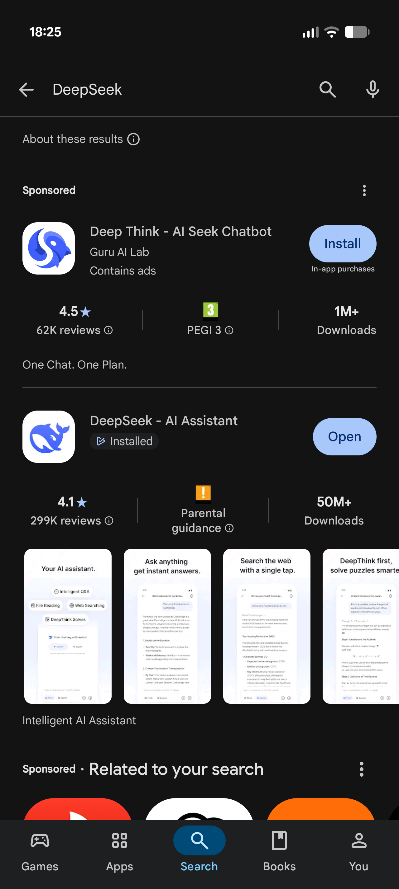
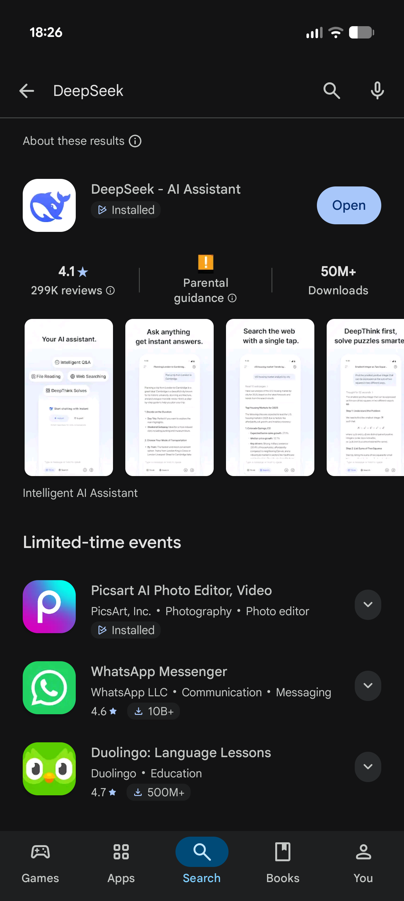

<h1 align="center">
  <picture>
    <source media="(prefers-color-scheme: dark)" srcset="https://raw.githubusercontent.com/hxreborn/playstore-adblock/master/assets/banner_dark.png">
    
  </picture>
</h1>

<p align="center">
  Xposed module that removes ads, sponsored apps, and promoted recommendations from the Google Play Store.
</p>

<p align="center">
  
  
  <a href="https://t.me/PlayStoreAdblock"></a>
</p>

## Screenshots

<div align="center">

<table>
  <tr>
    <th>Stock</th>
    <th>Patched</th>
  </tr>
  <tr>
    <td></td>
    <td></td>
  </tr>
</table>

</div>

## Requirements

- Android 11+ with an arm64-v8a device
- Xposed manager with libxposed API 101+, such as LSPosed

> [!WARNING]
> Hooking the Play Store can trip Google's device-certification or billing checks on devices without a working Play Integrity setup. This is inherent to modifying the Play Store.

## Install

1. Download one APK from [Releases](https://github.com/hxreborn/playstore-adblock/releases):
   - **Core** (`playstore-adblock-v<version>-core-arm64-v8a.apk`): ad blocking only, with no app icon or settings screen. This is the same module earlier releases shipped
   - **Full** (`playstore-adblock-v<version>-full-arm64-v8a.apk`): the same ad blocking plus optional Play Store filters and a settings app
2. Enable the module in your Xposed manager, scoped to Google Play Store (`com.android.vending`)
3. Force-stop the Play Store so it restarts with the module active

Core and Full are one package signed with the same key, so installing one replaces the other and the
module is still enabled afterwards. Core ignores the Full settings but keeps them, and installing Full again brings them
back. Force-stop the Play Store after switching.

> [!NOTE]
> If you still see ads or an empty placeholder shelf, clear the Play Store cache, force-stop it, and relaunch. Play Store keeps serving cached ad responses until they refresh.

## Optional filters (Full)

Every filter is off by default, and ad blocking never depends on them:

- **Content**: editorial promotion cards, the pre-registration games shelf, promoted search shelves
- **Account menu**: the notification badge, Help & feedback, Personalization in Google Play
- **Manage apps & device**: Play Protect, device sync, Ratings & reviews, Contributions
- **Navigation**: the Games, Apps, Books and You tabs, a minimal Search home, and a start screen
- **Play Store updates**: block Play Store self-updates (other apps keep updating)

The settings app saves changes on the device. **Apply and restart Play Store** sends them to your Xposed
manager, closes Play Store, and opens it again with the new filters. When a content filter changed it also
clears Play Store's cached feeds (`cache/streamdatastore`). If that clear fails, Play Store still restarts and
Apply keeps the changes pending for another attempt. Play Store refuses the restart while
it is installing apps or in a purchase. If Play Store doesn't respond, **Restart with root** makes the same
checks and clears the same folder through `su`, then opens Play Store again. A filter whose target is not found on a Play Store release is skipped,
and that screen looks as it does without the module.

If Play Store crashes three times within two minutes, the filters are skipped on the following launches while
ad blocking keeps working. Updating Play Store or the module, or **Apply and restart Play Store**, turns them back on.

Open the settings from the app drawer or from the module entry in your Xposed manager. The launcher icon can
be hidden in **Appearance and icon**.

To update Full, download the Full APK from Releases. Managers that install the first APK in a release
can replace Full with Core, so select the flavor when updating.

## Compatibility

| Play Store release | Version code | Status |
| --- | ---: | --- |
| 41.9.18-XX | 841918XX | unsupported |
| 42.9.17-XX | 842917XX | unsupported |
| 43.9.18-XX | 843918XX | supported |
| 44.9.20-XX | 844920XX | supported |
| 45.9.19-XX | 845919XX | supported |
| 46.9.20-XX | 846920XX | supported |
| 47.0.13-XX | 847013XX | supported |
| 47.6.28-XX | 847628XX | supported |
| 48.5.23-XX | 848523XX | supported |
| 49.9.19-XX | 849919XX | supported |
| 49.9.21-XX | 849921XX | untested |
| 50.1.33-XX | 850133XX | supported |
| 50.7.37-XX | 850737XX | supported |
| 51.0.19-XX | 851019XX | supported |
| 51.9.18-XX | 851918XX | supported |
| 52.2.25-XX | 852225XX | supported |
| 52.3.32-XX | 852332XX | supported |
| 52.4.41-XX | 852441XX | supported |
| 52.5.22-XX | 852522XX | supported |
| 52.6.26-XX | 852626XX | supported |
| 52.7.34-XX | 852734XX | supported |
| 52.8.55-XX | 852855XX | supported |
| 53.0.27-XX | 853027XX | supported |
| 53.3.21-XX | 853321XX | supported |
| 53.4.23-XX | 853423XX | supported |

Find your build either in Play Store → Settings → About or with:

```
adb shell dumpsys package com.android.vending | grep -E 'versionName|versionCode'
```

Builds not listed here are usually still compatible, since the module adapts to changes between
Play Store releases. If sponsored content appears, [open an issue](https://github.com/hxreborn/playstore-adblock/issues)
and include the version name and version code.

## Related

Also dislike ads in Google Discover, the launcher's -1 screen, or Google News? Try <a href="https://github.com/hxreborn/discover-ads-filter"> discover-ads-filter</a>, a sister module.

## License

[](https://github.com/hxreborn/playstore-adblock/blob/master/LICENSE)
